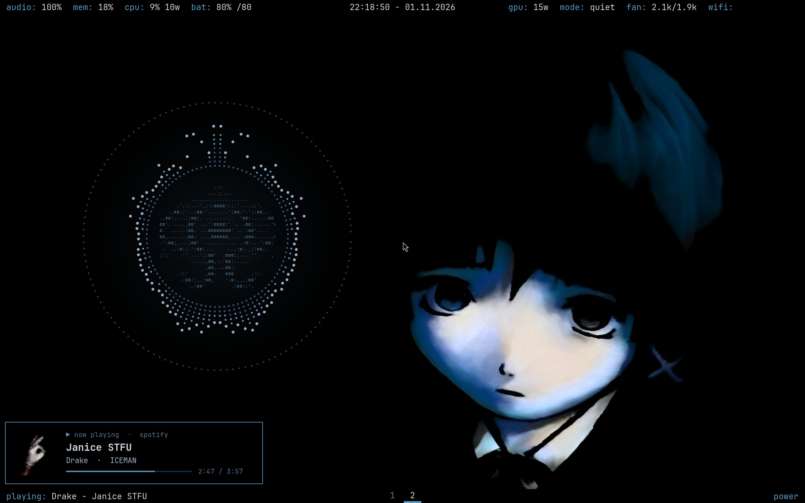
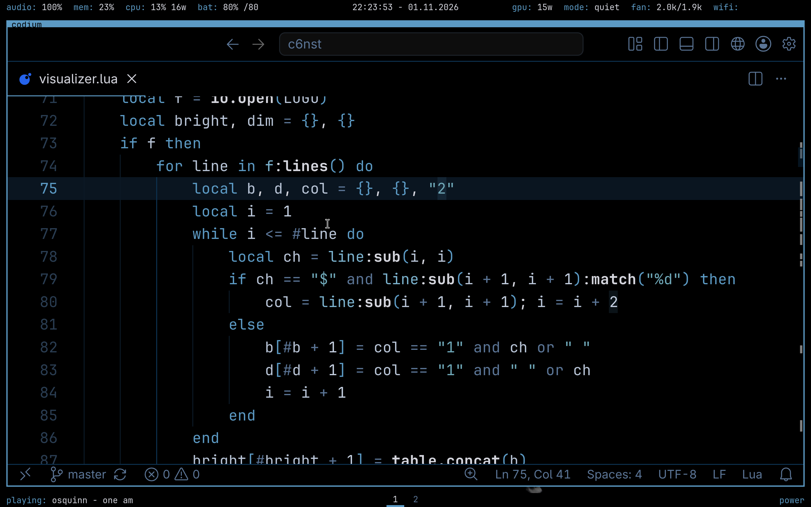

# lain

A Serial Experiments Lain themed config for [awesome](https://awesomewm.org) 4.3. Black and wired blue, text only.




## Features

- Text-only top and bottom bars: audio, memory, CPU (with RAPL watts), battery, GPU, ROG mode and fans, Wi-Fi, now playing
- Visualiser orb on the wallpaper, driven by cava, with the navi logo in the middle
- Now-playing card (click `playing:` in the bottom bar)
- Volume and brightness OSD, drop-down terminal, key help popup
- Per-monitor DPI, plus automatic laptop/external monitor setup with `screens.sh`

## Install

```sh
git clone https://github.com/kpawnd/lain.git
cd lain
cp -r awesome ~/.config/awesome
mkdir -p ~/.config/cava ~/.config/fastfetch ~/.config/navi-lock ~/.local/bin
cp cava/navi ~/.config/cava/navi
cp fastfetch/navi.txt ~/.config/fastfetch/navi.txt
cp navi-lock/bg.lua ~/.config/navi-lock/bg.lua
cp bin/navi-lock bin/rog-menu ~/.local/bin/
```

Put a wallpaper at `~/.config/awesome/wallpaper.jpg`. Without one the desktop is plain black.
The browser is `$BROWSER`, falling back to `thorium-browser`.

## Dependencies

`alacritty` `rofi` `picom` `cava` `playerctl` `pactl` `brightnessctl` `maim` `xclip` `yazi` `btop` `pavucontrol` `JetBrainsMono Nerd Font`

Lock screen: `i3lock-color` (falls back to `slock`), `Inter` font, `lua-lgi`

Optional: `asusctl` `udiskie` `xss-lock` `clipmenu`

Some widgets and `rog-menu` are written for an ASUS ROG laptop (battery, fans, dGPU, refresh-rate switching).

## Keys

Press `Super + /` to see all keybindings.

| Key | Action |
| --- | --- |
| `Super + Enter` | terminal |
| `Super + Space` | app launcher |
| `Super + Q` | close window |
| `Super + Tab` | cycle layout |
| `Super + 1..5` | workspace |
| `` Super + ` `` | drop-down terminal |
| `Super + Esc` | power menu |

## License

[MIT](LICENSE)
